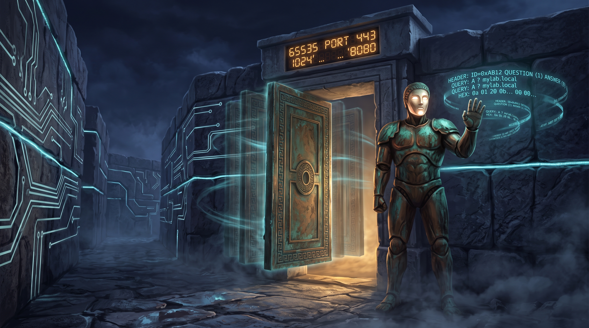
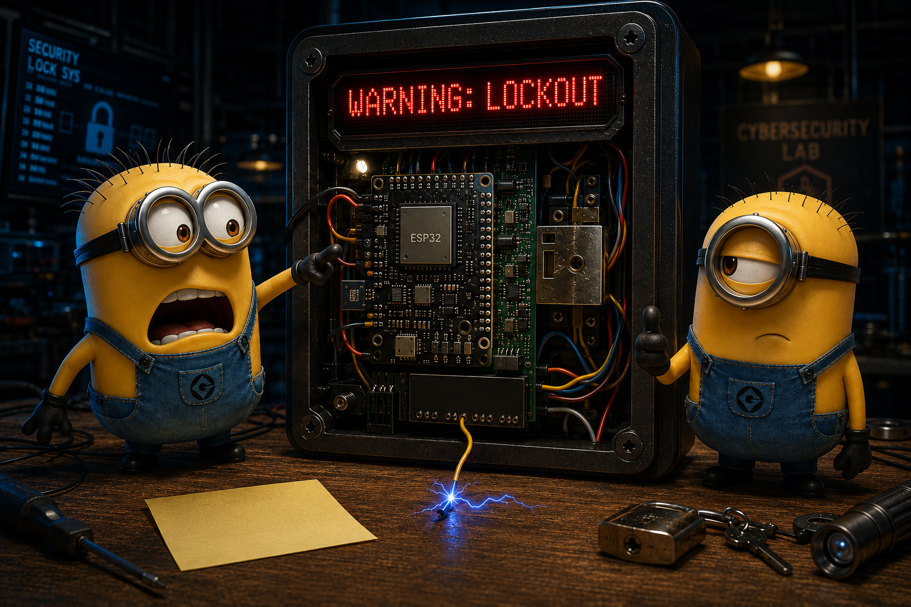

# Embedded Security Challenge 2026 — Set 2

Welcome to Embedded Security Challenge 2026 Set #2!! The gateway has stopped whispering down a wire and started shouting over the air. Three challenges this week — one on the radio, one on the web, and one wired. Good luck!

| # | Challenge | Points |
|---|---|---|
| 3 | [Airwave Template](#airwave-template-200-pts) | 200 |
| 4 | [Hidden Portal](#hidden-portal-250-pts) | 250 |
| 5 | [Minions Lockout](#minions-lockout-350-pts) | 350 |

---

## Airwave Template (200 pts)

Daedalus's smart home has an entrance that keeps moving, though never far from where you last found it. The doorman will answer every question you have, but you have to follow his rules. So begin with a question you already know the answer to. More challenges await. Always do your research.

 

## Hidden Portal (250 pts)

Smart homes can often be dumber than regular homes. This Metropolis has flying trains, but the developers relied too much on vibe coding and left things in places they shouldn't.

You can capture the secrets of Gru with the right skillset. When in doubt, search, inspect, or listen. Some things hide more than they show. Be careful not to get locked out. Also remember... A house that starts over does not keep its old locks.

 

## Minions Lockout (350 pts)

Margo is going to thee prom  and her father secured the alarm. Try to get in without sounding the alarm. Every time an intruder is detected lockout mode starts. A reset will be necessary and the password changes. This challenge might sound bruteal but if you clock out your feelings the solution prompts itself.

 
