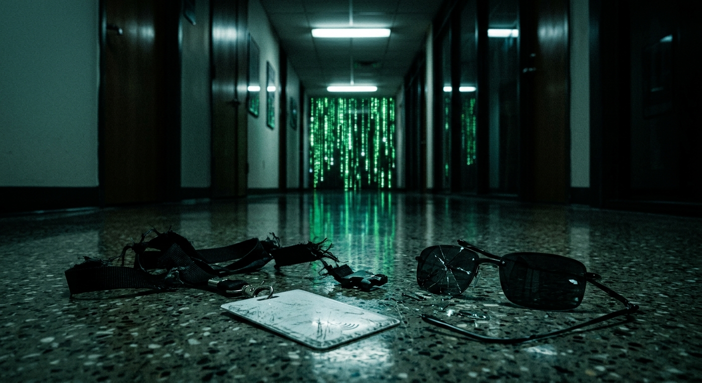
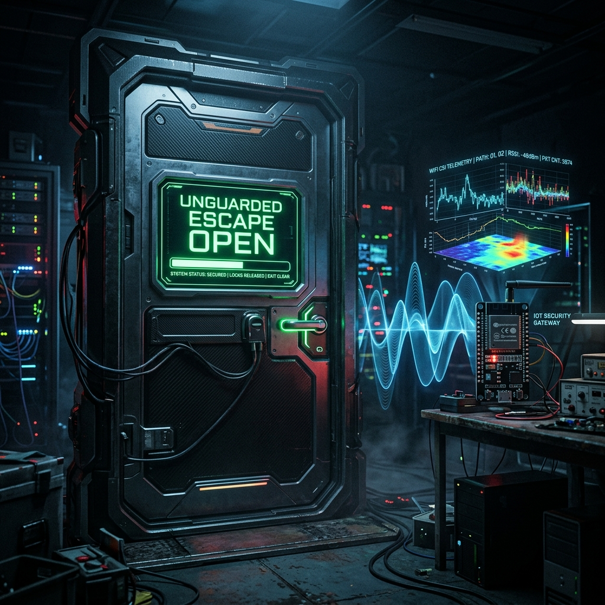

# Embedded Security Challenge 2026 — Set 3

At last we reached the final Embedded Security Challenge 2026 set of challenges. Badges, radios, and more. We hope you prepared well for this final phase of this battle!!

| # | Challenge | Points |
|---|---|---|
| 6 | [Silicon Badge](#silicon-badge-450-pts) | 450 |
| 7 | [Smart Gateway Escape](#smart-gateway-escape-400-pts) | 400 |

---

## Silicon Badge (450 pts)

An Agent lost his card and his badge while fighting you. You realized that these tools can help you access information never seen before but unfortunately this soldier doesn't have access to anything classified.
When the same cat crosses the same doorway, look again. Many things can be revealed if you manage to unlock their secret safe full of keys. Blue teeth are not for smiles. Find the name of the Architect.
All of this will make sense soon. Don't forget your training.
Prepare for a deep dive.

 

## Smart Gateway Escape (400 pts)

I don't know much about this place. I've been waiting in the dark for years, hoping the exit door will finally be left unguarded. In past years, a few brave souls tried to escape; none of them made it out. The last attempt was around New Year's Eve, and I don't think that guy is still with us. He left some telemetry notes hidden somewhere on the network, though I never could make sense of them. All I know is that if you find those notes, you can tell us when is the right time for our escape. Until then, I will just wait.

 
